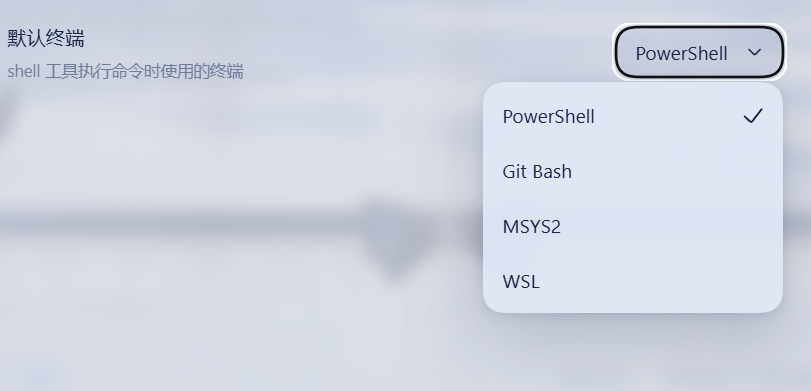

# dsh-bash-terminal-ts

> 🌐 [简体中文](README.md) | [English](README.en.md) | [Français](README.fr.md) | [Deutsch](README.de.md) | [Italiano](README.it.md) | [Русский](README.ru.md) | [Español](README.es.md) · Community: [LINUX DO](https://linux.do) · [GitHub](https://github.com/drscrewdriver/dsh-bash-terminal-ts)

A DeepSeek Harness (DSH) plugin: one `shell` tool that runs commands through **PowerShell / Git Bash / MSYS2 / WSL** on Windows, plus an **interactive terminal** tool — all following the terminal **you** choose in the Web UI settings.


> **TypeScript rewrite of `MAXeaglet/dsh-bash-terminal`**, with working MSYS2/MINGW64 support. Compatibility lines are cut per DSH host segment; all lines share the package name `dsh-bash-terminal-ts` and are distinguished by npm dist-tag:
>
> | DSH segment | Branch | Plugin series | npm dist-tag |
> |-------------|--------|---------------|--------------|
> | `0.1.0-rc.2 – 0.2.1-rc.3` (exact 18-version enumeration) | `main` (this branch, cross-version trunk) | 0.8.x | `latest` |
> | `>=0.2.0-rc.1 <0.2.1-0` | `compat/0.2.0` (historical, frozen) | 0.7.x | `dsh-0.2.0` |
> | 0.1.7-rc.1 – 0.1.7.x | `compat/0.1.7` | 0.6.x | `dsh-0.1.7` |
> | 0.1.5-alpha.1 – 0.1.5-rc.x | `ts/0.1.5` (historical, frozen) | ≤ 0.5.2 | `dsh-0.1.5` |
> | 0.1.2-alpha.1 – 0.1.2-rc.x | early `main` commits (frozen at tag) | ≤ 0.4.2 | `dsh-0.1.2` |
>
> Pick the line that covers your DSH build; the version series never overlap, so a `^` install cannot resolve across lines.

## Features

| Backend | Runs | Syntax / paths | Env vars |
|---------|------|----------------|----------|
| `powershell` (default) | `pwsh -NoLogo -NoProfile -NonInteractive -Command <cmd>` | PowerShell; `C:\\...` | `$env:NAME` |
| `gitbash` | Git for Windows `bash -lc <cmd>` | POSIX; `/d/workspace`; PATH includes `/usr/bin` and `/mingw64/bin` | `$NAME` |
| `msys2` | MSYS2 `bash -lc <cmd>` (`C:\msys64\usr\bin\bash.exe`) | POSIX; `/c/...`; PATH includes `/usr/bin` and `/mingw64/bin` (gcc / make) | `$NAME` (MSYSTEM=MINGW64 injected) |
| `wsl` | `wsl [-d <distro>] -e bash -lc <cmd>` | Linux; `/mnt/d/...` | `$NAME` (via WSLENV) |

- **User decides, the AI cannot override**: pick the default terminal in Settings -> General -> Default terminal (PowerShell / Git Bash / MSYS2 / WSL). The setting persists through the DSH settings system; the `shell` tool always obeys it.
- **Official sandbox seam**: the `shell` tool resolves the DSH sandbox policy per call and confines PowerShell argv through `ctx.sandbox` — same fail-closed `SandboxUnavailableError` semantics as the shipped executors. Git Bash, MSYS2 and WSL run unconfined: WSL is its own Linux VM, while Git Bash and MSYS2 cannot run under the DSH Windows ACL restricted-token runner (Cygwin/MSYS2 aborts with `CreateFileMapping` Win32 error 5). Official `sandbox_permissions` / `justification` escalation and denial markers included.
- **Interactive terminal**: the `terminal` tool opens persistent real-PTY sessions over node-pty — on non-Windows via the official `ctx.subprocess.spawnTerminal` seam, on Windows directly through node-pty because the upstream seam's process inspector is POSIX-only. Actions `open` / `send` / `read` / `signal` / `close`; shell state persists across calls; sessions are managed as background jobs and auto-close when idle.
- **Background execution** via the generic jobs registry (`run_in_background` / `job_output` / `job_kill`).
- **Pinned POSIX runtime payload (a first-class fifth backend, off by default)**: package `@drscrewdriver/posix-runtime-win32-x64` (naming policy: our artifact names never carry bash/gitbash/msys tokens - the tree inside is Git-for-Windows). Two opt-in layers: `enablePosixPayload: true` (operator gate - runs the digest check at startup) plus a "POSIX payload" row switch `shellPayload` in Settings (default off - decides whether a provisioned payload may enter pickers or be chosen as the default terminal). It has its own catalog row, tool description (`bash -lc`), interactive terminal and `payload-unconfined` enforcement facts - it never substitutes for the Git Bash slot. Nothing is downloaded at install - provision it yourself from a LOCAL PortableGit SFX (`node scripts/provision-payload.mjs --from <sfx>`: reverse-unpack, SHA-256 pin, fully self-managed; no third-party payload packages are consumed). A detected WSL distro logs an advisory hint (a real WSL bash is usually the better shell) but does not hide the payload row - the digest gate is the only hard no, and a payload that fails it is never run, never silently replaced.
- **Terminal-semantics preset templates (`agent-presets/`)**: distributable Agent Presets that declare default terminal, command syntax and a "Terminal authority" anchor at the preset layer (PowerShell / Git Bash / MSYS2 / WSL2 / pinned-payload variants), installed via `npm run presets:install` - the benchmark-style hedge against plugins that rewrite default-terminal semantics at install time: the same bash-first experience, chosen by you in a layer that is auditable and reproducible.

## Screenshots

The **Default terminal** row in Settings -> General: the user picks PowerShell / Git Bash / MSYS2 / WSL, and the `shell` tool obeys that choice — the model cannot override it.



## Install

The package ships the official `dsh.bundle` manifest (its own `cordis.patch.yml`): listing `dsh-bash-terminal-ts` in a profile's `dsh.profile.bundles` auto-applies the mount — no manual profile edits.

```powershell
npm install -g dsh-bash-terminal-ts
dsh plugin --profile web add dsh-bash-terminal-ts        # adds to profile bundles + applies the patch
powershell -ExecutionPolicy Bypass -File install.ps1 install   # patches the DSH settings-UI allowlist (see below)
# restart dsh web
```

> **DSH limitation**: the Web settings client only exposes a hard-coded allowlist of settings namespaces (`dsh-host-apiproxy`); third-party settings writes are refused with `settings-not-exposed` otherwise. `install.ps1` patches the allowlist (with a backup) — re-run it after upgrading DSH; `install` / `uninstall` restores it.

### pnpm users: the node-pty build-script notice

This plugin depends on the native PTY library [`node-pty`](https://www.npmjs.com/package/node-pty) (Microsoft-maintained, the same library VS Code uses) for the interactive `terminal` tool. **As of 0.7.1 it is pinned to `1.2.0-beta.15`** (the same version both DSH host lines use): the tarball ships prebuilt binaries for every platform, so even when pnpm 10+ skips the install script, the runtime loader falls back to `prebuilds/<platform>-<arch>/` and **runs without compiling**. The notice at the end of `pnpm add` only reports the skipped script; approve once to silence it:

```text
Error: ERR_PNPM_IGNORED_BUILDS
  Ignored build scripts: node-pty@1.2.0-beta.15
```

```powershell
pnpm approve-builds      # pick node-pty interactively
# or declare it in the profile's package.json, then rebuild:
#   "pnpm": { "onlyBuiltDependencies": ["node-pty"] }
pnpm rebuild node-pty
```

> This is the **only** own dsh plugin with a native dependency; the other 0.2.0-line plugins (search-index, session-steward, patch-edit-plus, browser-cdp, date-wrapper) and live-token-stats are pure-JS and install on pnpm without any approval.

For local development (junction install, source changes apply instantly) see the Chinese README's development section.

## Shell aliases: get Git Bash / MSYS2 into the host's own terminal menu (optional)

This plugin's own “Terminal (multi-shell)” tab needs nothing extra — all four shells work out of the box. The **host's** official right-sidebar terminal is a different story: its menu is built by `discoverShells`, which keys a Map by the executable **file name** and keeps the earliest entry, and both Git Bash and MSYS2 ship as `bash.exe`. At most one of them can ever appear there.

The bundled `cordis.patch.yml` therefore adds two candidates that carry a file name of their own: `C:\msys64\usr\bin\msys-bash.exe` and `C:\Program Files\Git\bin\git-bash.exe`. Both are hard links (same inode, no extra space, delete them to revert), and they only produce a menu entry if they actually exist on the machine. A missing link is skipped per candidate, so the menu stays exactly as it was and nothing fails.

A third candidate is the pinned POSIX payload's menu entry: `%LOCALAPPDATA%\dsh-bash-terminal-ts\payloads\bash-terminal\bin\bash-terminal.exe` (the path is built from LOCALAPPDATA via `!!js`, so it adapts per user). It is also a hard link into the payload's `bin\`, deliberately named `bash-terminal.exe` - the menu's `bash` key already belongs to the WSL forwarder, and re-using it would push WSL out. The link and the stable junction are created automatically by `scripts/provision-payload.mjs` (only after the digest gate passes) or `node scripts/link-shells.mjs`, inside the user-writable LOCALAPPDATA - no elevation needed. Machines that never provisioned a payload simply have no file there and the candidate is skipped.

Create the aliases (either route):

```powershell
# A. the script shipped with this package: creates what it can, prints the elevated
#    command verbatim for what it cannot
node scripts/link-shells.mjs

# B. by hand (the MSYS2 line works as a standard user; the Git line needs an ELEVATED PowerShell / cmd)
cmd /c mklink /H "C:\msys64\usr\bin\msys-bash.exe"       "C:\msys64\usr\bin\bash.exe"
cmd /c mklink /H "C:\Program Files\Git\bin\git-bash.exe" "C:\Program Files\Git\bin\bash.exe"
```

With no administrator terminal at hand, pull one up from an ordinary session (Windows asks once; click **Yes**):

```powershell
Start-Process cmd -Verb RunAs -Wait -ArgumentList '/c','mklink /H "C:\Program Files\Git\bin\git-bash.exe" "C:\Program Files\Git\bin\bash.exe" > "%TEMP%\mklink.log" 2>&1'
Get-Content "$env:TEMP\mklink.log"
```

The alias behaves exactly like the original (measured on `git-bash.exe -i`: `MSYSTEM=MINGW64`, POSIX root `C:\Program Files\Git\`, `$0=/usr/bin/bash`, `git` on PATH) - because the link stays inside `Git\bin\`, so bash still derives the same root from its own path.

The Git line cannot avoid elevation, for two independent reasons: `CreateHardLink` requires write access to the **source** file, which Program Files denies a standard user (so the link cannot be created from somewhere else either); and the link has to stay inside `Git\bin\`, because bash derives its POSIX root from its own path and loses `/usr/bin` and `/etc` anywhere else.

> **Hand it to an agent** — paste this to an agent running with full (administrator) permissions:
>
> ```text
> Create two shell alias hard links for the DSH host's official terminal, with administrator rights:
>   cmd /c mklink /H "C:\msys64\usr\bin\msys-bash.exe" "C:\msys64\usr\bin\bash.exe"
>   cmd /c mklink /H "C:\Program Files\Git\bin\git-bash.exe" "C:\Program Files\Git\bin\bash.exe"
> Skip creation if the target already exists; never overwrite it. Then verify with this package's
> `node scripts/link-shells.mjs` - both lines must report `ok ... (same inode, nlink=2)`. Finally
> restart DSH so the official terminal re-discovers its shells.
> Constraints: do not copy the files, do not create symbolic links, do not put the links in any
> other directory, do not modify bash.exe itself. If you are not already in an administrator
> context, start one with `Start-Process cmd -Verb RunAs` (Windows prompts once) and redirect the
> output to a file you can read back. If elevation fails, report the exact command and error code
> back to me instead of falling back to a copy.
> ```

After restarting DSH, the official “New” dropdown should list `msys-bash.exe` and `git-bash.exe`, while plain `bash` (on Windows that resolves to the WSL forwarder `C:\Windows\System32\bash.exe`) **must still be there** — this package never claims the `bash` key for Git and pushes WSL out of the menu.

> ⚠️ **MSYS2 needs one more step: a PATH guard in `~/.bashrc`** (`C:\msys64\home\<you>\.bashrc`). The host starts every candidate as an interactive **non-login** shell (`shellCandidates` is a plain string array, so `-l` cannot be passed), and a non-login shell never sources `/etc/profile` — which is exactly where MSYS2 adds `/usr/bin` to PATH. Without this, `msys-bash.exe` opens fine but `uname`/`ls` report “command not found”. Git Bash does **not** need it: it injects `/usr/bin` and `/mingw64/bin` itself (verified: `cygpath` and `git` work immediately).
>
> ```bash
> # >>> dsh-bash-terminal-ts PATH guard >>>
> case ":$PATH:" in
>   *":/usr/bin:"*) ;;
>   *) PATH="/usr/bin:$PATH" ;;
> esac
> # <<< dsh-bash-terminal-ts PATH guard <<<
> ```
>
> Prepending is safe here because `/usr/bin/gcc.exe` does not exist, so the mingw64 toolchain still resolves first (verified: `command -v gcc` stays `/mingw64/bin/gcc`). **Re-measure after any `pacman -S mingw-w64-*` install**, or the guard can start shadowing your compiler instead. To revert: delete everything between the two sentinel comments.

## Sandbox

- `danger-full-access` sessions run directly (no wrapping).
- Confined sessions wrap PowerShell argv through `ctx.sandbox.confine`; fail-closed when no backend is available.
- Git Bash is never wrapped: the Windows ACL restricted-token runner cannot host Cygwin/MSYS2 (`CreateFileMapping` Win32 error 5); results report `enforcement: gitbash-unconfined`.
- MSYS2 is never wrapped either (same Cygwin/MSYS2 runtime incompatibility); results report `enforcement: msys2-unconfined`.
- WSL is never wrapped (its VM isolation is the sandbox; results report `enforcement: wsl-isolation`).
- Denied calls render the official `[sandbox: file access denied under <mode> mode]` marker plus a same-turn escalation hint; the model may retry once with `sandbox_permissions` + `justification` (user-approved via `ctx.approval`).
- Note: when DSH's Windows ACL runner is available, it confines PowerShell; Git Bash and MSYS2 remain unconfined due to the Cygwin/MSYS2 incompatibility.

## Interactive terminal

`terminal` actions: `open` (start a session on the configured default terminal), `send` (write input + read new output), `read`, `signal` (SIGINT = Ctrl+C etc.), `close`, `list` (enumerate live sessions). Reads wait for output to settle (quiet 300ms, cap 5s) so `send` returns the complete reply; buffer overflow reports a `truncated` notice. State (cwd / variables / aliases) persists across calls; end input with `\\n`. Sessions are background jobs (`job_kill` works) and auto-close after 10 idle minutes (`idleMs` overrides on open).

## Interactive terminal known limits (ConPTY)

- **Windows PowerShell 5.1 cannot start in a ConPTY** (0x8009001d) — install [PowerShell 7](https://github.com/PowerShell/PowerShell/releases) for interactive PowerShell (one-shot commands are unaffected).
- **wsl.exe interactive mode may hit a WSL service RPC error under ConPTY** (0x8007072c, intermittent) — one-shot `wsl -e bash -lc ...` works; for interactive WSL prefer a real terminal (Windows Terminal / WSL app) or retry.
- **node-pty accepts no named signals on Windows**: `signal` maps `SIGINT` to Ctrl+C (`\x03`); other signals (`SIGTERM` / `SIGKILL` / `SIGTSTP` / `SIGHUP`) degrade to terminating the session.
- Git Bash interactive sessions work fully.

## Bottom terminal (embedded browser shell, 0.8.0+)

A terminal for a **human**, sharing the same shell knowledge as the model-facing `shell`/`terminal` tools but a different environment.

**Entry point**: the bottom workbench of [dsh-better-sidebar](https://www.npmjs.com/package/dsh-better-sidebar) 0.25+. This plugin registers **its own tab there, "Terminal (multi-shell)"**, which reaches all four shells:

| Host | What happens |
|---|---|
| Terminal controller present (DSH 0.2.0-rc.2+, official CLI/GUI builds) | The official "Terminal" row is powered by the host and keeps working; this plugin **does not touch** `webTerminals` and only adds its multi-shell tab |
| No controller mounted (some Desktop builds, where the official row is dead) | The multi-shell tab works regardless. Turn on "Take over the official terminal row" only if you specifically need that official row lit up |

Why a tab of our own: the official shell menu **de-duplicates by executable file name** and keeps the earliest entry, so a bare `bash` on Windows resolves to `C:\Windows\System32\bash.exe` - the WSL forwarder - and Git Bash (also `bash.exe`) can never join it. Our tab picks by catalog ROW, so all four coexist. The official row is still there; this package adds exactly one entry to it (see below).

> **The take-over switch is off by default, and that is a correctness rule, not caution.** The host's controller client registers the same `webTerminals` name, cordis **refuses a second provider of one name**, and the loser is the one that throws - the controller's provide is unguarded, so if we get there first we take down the first-party terminal and the page becomes `Failed to load plugins / web boot: 1 entry did not activate` (measured on 0.2.0-rc.2). When you do switch it on, the plugin **reads the service live first** and only publishes if the name is free, then states the outcome in the settings row ("taken over" / "the host already publishes it"). So enabling it on a host that has a controller cannot break anything.

The tab registers only when `betterSidebar` is available, through `ctx.inject(['betterSidebar'])` so arrival order does not matter (with a soft read as fallback) - and it must never read `ctx.betterSidebar` as a property: the client context is a Proxy and an undeclared service name throws `cannot get property "betterSidebar" without inject`. xterm is **bundled into this plugin's own artifact** - DSH's client module table resolves only platform seed words, shell-owned modules, registered package factories and boot modules, so an external `require("@xterm/xterm")` fails at mount with "missed the module table". The settings section states which path you are on ("The host terminal is in charge").

The settings have **two landing points**, and both render the SAME component (a change cannot land on one and miss the other):

| Surface | Slot | Host lines |
|---|---|---|
| Plugin detail page (bundle settings) | `plugins.bundle.config`, keyed by the package name | 0.1.7-rc.1+ / 0.2.0 |
| A tab under the family section | `dsh-family.tab` (container: dsh-thinking-levels) | as above, and TL must be installed |

Both arms are registered and whichever has a renderer wins. **When there is no family container to carry the card, this plugin registers its own top-level `settings.section`** (id `bash-terminal`; it never shadows `dsh-family`, because two entries under one id produce two navigation rows). That decision is taken when the host *declares* the section - opening the settings panel - not at apply time, because the container belongs to another plugin's client and deciding early means betting on bundle order.

Two further arms exist for cross-version reach: `settings.plugin.item` (keyed by the settings namespace) is the 0.1.2/0.1.5 equivalent of the bundle detail card, and the `shell.overlay` panel renders **only when the host itself reports that it has no settings page** (the component returns null otherwise). That classification reads neither a version string nor an imported host package - host packages live in the application's tree and a plugin cannot resolve them - but the capability face of the settings service: `installSection` present → 0.1.2/0.1.5 (page exists); only `register` → 0.1.0/0.1.1 (the `settings.*` slot map is declared but **no page renders it**, so a registered card would be unreachable and the plugin must bring its own entry); neither → 0.1.7+/0.2.0 (page exists).

- Activation switches: Git Bash / MSYS2 / WSL. A switch means *allowed*; usable = allowed ∧ detected, so “detected means on” needs no extra configuration. **PowerShell is the floor and cannot be turned off.**
- `defaultShell` only offers rows that are activated ∧ available, validated server-side; a stale value falls back through `[powershell, gitbash, msys2, wsl]` with a visible notice and is never rewritten, and an empty candidate set falls back to pwsh → powershell.exe → cmd.exe.
- The browser terminal starts PowerShell **without `-NoProfile`** (your aliases and prompt survive) and with a real terminal type, unlike the tool path, which pins `TERM=dumb`/`NO_COLOR=1` because a parseable one-shot output is correct there.
- It does **not** add anything for the model: no tool, no system-prompt section, no sandbox approval. Routes are loopback-only (a DNS-rebinding/LAN guard, not authentication).
- MSYS2 is offered as `usr\bin\bash.exe` with `MSYSTEM=MINGW64`; `msys2.exe`/`git-bash.exe` are refused because they open their own window and return zero bytes on a pipe.
- What the official menu does change: this package's `cordis.patch.yml` overrides the host `terminal-controller` row's `shellCandidates`, **prepending one entry only** - `C:\msys64\usr\bin\msys-bash.exe`, a hard link that gives MSYS2 a distinct file name so de-duplication stops erasing it. The stock candidates are left untouched. Pinning `Git\bin\bash.exe` ahead of them (an earlier revision did) would claim the `bash` key from the **WSL forwarder** and delete WSL from the menu; and Git cannot be renamed without a link inside `C:\Program Files\Git\bin\`, which needs elevation and must stay inside the Git tree because bash derives its POSIX root from its own path. So Git Bash comes from this plugin's tab instead.
- Two things that override costs: the patch replaces that row's config **whole**, so all eleven keys are spelled out and `test/webterminals.ts` asserts both the full key set and that every stock candidate survives; and MSYS2's `/usr/bin` is missing in a non-login shell (the host passes `-i`, guessed from the file name, with no env channel), which is why `C:\msys64\home\<user>\.bashrc` needs an idempotent `PATH="/usr/bin:$PATH"` guard. Measured on the live host: `cmd.exe | msys-bash.exe | bash(=System32, WSL) | powershell`.

Details, the argv/env table and the measured smoke output are in `README.md` (Chinese), which is the maintained copy.

## Config

Web UI: Settings -> General -> Default terminal. Plugin row `config` overrides: `defaultShell`, `timeoutMs`, `maxTimeoutMs`, `pwshPath`, `gitBashPath`, `msys2Path`, `wslPath`, plus the bottom-terminal fields `shellGitBash`, `shellMsys2`, `shellWsl`, `shellPayload`, `wslDistro`, and the payload fields `enablePosixPayload`, `payloadPosixPath` (restart to apply).

## Uninstall

```powershell
powershell -ExecutionPolicy Bypass -File install.ps1 uninstall
```

## Tests

```powershell
node test/unit.mjs && node test/apply.mjs && node test/client.mjs && node test/terminal.mjs
```
