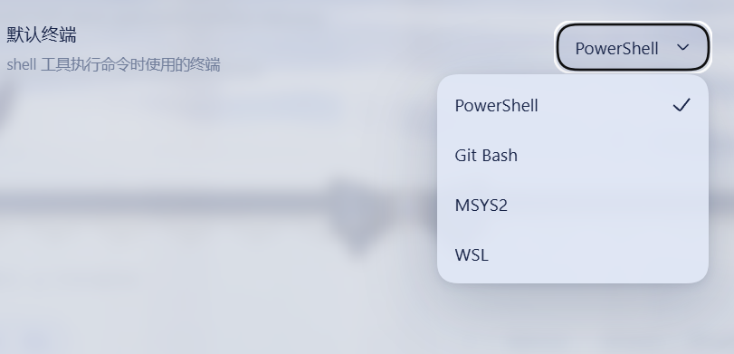

# dsh-bash-terminal-ts

> 🌐 [简体中文](README.md) | [English](README.en.md) | [Français](README.fr.md) | [Deutsch](README.de.md) | [Italiano](README.it.md) | [Русский](README.ru.md) | [Español](README.es.md) | [Português](README.pt.md) · Comunidade: [LINUX DO](https://linux.do) · [GitHub](https://github.com/drscrewdriver/dsh-bash-terminal-ts)

Um plugin de DSH (DeepSeek Harness): uma única ferramenta `shell` que executa comandos através de **PowerShell / Git Bash / MSYS2 / WSL / Niubash** no Windows, além de uma ferramenta de **terminal interativo** — tudo seguindo o terminal que **você** escolher nos ajustes da interface web.


> **Reescrita em TypeScript de `MAXeaglet/dsh-bash-terminal`**, com suporte MSYS2/MINGW64 funcional. As linhas de compatibilidade são cortadas por segmento de host do DSH; todas as linhas compartilham o nome de pacote `dsh-bash-terminal-ts` e são distinguíveis pelos dist-tags do npm:
>
> | Segmento DSH | Branch | Série do plugin | dist-tag npm |
> |-------------|--------|---------------|--------------|
> | `>=0.1.0-rc.2 <0.3.0-0` (intervalo limitado) | `main` (este branch, tronco entre versões) | 0.8.x | `latest` |
> | `>=0.2.0-rc.1 <0.2.1-0` | `compat/0.2.0` (histórica, congelada) | 0.7.x | `dsh-0.2.0` |
> | 0.1.7-rc.1 – 0.1.7.x | `compat/0.1.7` | 0.6.x | `dsh-0.1.7` |
> | 0.1.5-alpha.1 – 0.1.5-rc.x | `ts/0.1.5` (histórica, congelada) | ≤ 0.5.2 | `dsh-0.1.5` |
> | 0.1.2-alpha.1 – 0.1.2-rc.x | commits iniciais de `main` (congelados por tag) | ≤ 0.4.2 | `dsh-0.1.2` |
>
> Escolha a linha que cubra a sua versão do DSH; as séries de versão nunca se sobrepõem, então uma instalação com `^` não pode resolver entre linhas.

## Funcionalidades

| Backend | Execução | Sintaxe / caminhos | Variáveis de ambiente |
|---------|------|----------------|----------|
| `powershell` (padrão) | `pwsh -NoLogo -NoProfile -NonInteractive -Command <cmd>` | PowerShell; `C:\\...` | `$env:NAME` |
| `gitbash` | `bash -lc <cmd>` do Git for Windows | POSIX; `/d/workspace`; PATH inclui `/usr/bin` e `/mingw64/bin` | `$NAME` |
| `msys2` | MSYS2 `bash -lc <cmd>` (`C:\msys64\usr\bin\bash.exe`) | POSIX; `/c/...`; PATH includes `/usr/bin` and `/mingw64/bin` (gcc / make) | `$NAME` (MSYSTEM=MINGW64 injected) |
| `wsl` | `wsl [-d <distro>] -e bash -lc <cmd>` | Linux; `/mnt/d/...` | `$NAME` (via WSLENV) |
| `niu` | [Niubash](https://github.com/unixwin/niubash) `niu -lc <cmd>` (bash 5.3 nativo em Rust, sem camada de emulação MSYS) | POSIX; tradução determinística de caminhos para `C:\...` and `/c/...`; a camada de comandos é WinuxCmd (178 applets) | `$NAME` |

- **O usuário decide, a IA não pode mudar**: escolha o terminal padrão em Configurações -> Geral -> Terminal padrão (PowerShell / Git Bash / MSYS2 / WSL). O ajuste é persistido pelo sistema de settings do DSH; a ferramenta `shell` sempre obedece a ele.
- **Costura de sandbox oficial**: a ferramenta `shell` resolve a política de sandbox do DSH em cada chamada e envasa o argv do PowerShell através de `ctx.sandbox` — a mesma semântica fail-closed `SandboxUnavailableError` dos executores nativos. Git Bash, MSYS2 e WSL rodam sem envasamento: WSL é sua própria VM Linux, enquanto Git Bash e MSYS2 não podem rodar sob o runner de token restrito com ACL do Windows do DSH (Cygwin/MSYS2 aborta com erro Win32 5 em `CreateFileMapping`). Escalada oficial `sandbox_permissions` / `justification` e marcadores de recusa incluídos.
- **Terminal interativo**: a ferramenta `terminal` abre sessões persistentes em PTY real via node-pty — fora do Windows pela costura oficial `ctx.subprocess.spawnTerminal`, no Windows diretamente pelo node-pty, porque o inspetor de processos dessa costura a montante é exclusivo de POSIX. Ações `open` / `send` / `read` / `signal` / `close`; o estado do shell persiste entre chamadas; as sessões são gerenciadas como jobs em segundo plano e se fecham sozinhas quando ociosas.
- **Execução em segundo plano** pelo registro genérico de jobs (`run_in_background` / `job_output` / `job_kill`).
- **Carga de tempo de execução POSIX com versão pinada (quinto backend de primeira classe, desligado por padrão)**: pacote `@drscrewdriver/posix-runtime-win32-x64` (política de nomenclatura: nossos nomes de artefato nunca carregam os tokens bash/gitbash/msys - a árvore interna é o Git-for-Windows). Duas camadas opt-in: `enablePosixPayload: true` (porta do operador - roda a checagem de resumo na inicialização) mais o interruptor da linha “POSIX payload” `shellPayload` nos Configurações (padrão desligado - decide se uma carga provisionada pode entrar nos seletores ou ser escolhida como terminal padrão). Tem sua própria linha de catálogo, descrição de ferramenta (`bash -lc`), terminal interativo e fatos de fiscalização `payload-unconfined` - nunca substitui o slot do Git Bash. Nada é baixado na instalação - provisione você mesmo a partir de um SFX PortableGit LOCAL (`node scripts/provision-payload.mjs --from <sfx>`: descompacta ao contrário, pin SHA-256, totalmente autogerenciado; nenhum pacote de carga de terceiros é consumido). Uma distribuição WSL detectada registra uma dica informativa (um bash WSL real costuma ser o melhor shell), mas não esconde a linha da carga - a porta de resumo é o único veto duro, e uma carga que falha nela nunca é executada, nunca é trocada em silêncio.
- **Modelos preset de semântica de terminal (`agent-presets/`)**: Agent Presets distribuíveis que declaram o terminal padrão, a sintaxe de comandos e uma âncora de “Autoridade do terminal” na camada de preset (variantes PowerShell / Git Bash / MSYS2 / WSL2 / carga pinada), instalados com `npm run presets:install` - a réplica ao estilo benchmark contra plugins que reescrevem a semântica do terminal padrão no momento da instalação: a mesma experiência bash-first, escolhida por você em uma camada auditável e reproduzível.

## Capturas de tela

A linha **Terminal padrão** em Configurações -> Geral: o usuário escolhe entre PowerShell / Git Bash / MSYS2 / WSL, e a ferramenta `shell` obedece essa escolha — o modelo não pode sobrescrevê-la.



## Instalação

O pacote traz o manifesto oficial `dsh.bundle` (seu próprio `cordis.patch.yml`): listar `dsh-bash-terminal-ts` em `dsh.profile.bundles` de um perfil aplica a montagem automaticamente — sem edição manual do perfil.

```powershell
npm install -g dsh-bash-terminal-ts
dsh plugin --profile web add dsh-bash-terminal-ts        # adds to profile bundles + applies the patch
powershell -ExecutionPolicy Bypass -File install.ps1 install   # patches the DSH settings-UI allowlist (see below)
# restart dsh web
```

> **Limitação do DSH**: o cliente de ajustes web expõe apenas uma allowlist fixa de namespaces de settings (`dsh-host-apiproxy`); sem ela, escritas de settings de terceiros são recusadas com `settings-not-exposed`. O `install.ps1` corrige a allowlist (com backup) — rode-o de novo após atualizar o DSH; `install` / `uninstall` a restauram.

### Usuários de pnpm: o aviso de build script do node-pty

Este plugin depende da biblioteca nativa de PTY [`node-pty`](https://www.npmjs.com/package/node-pty) (mantida pela Microsoft, a mesma que o VS Code usa) para a ferramenta `terminal` interativa. **Desde a 0.7.1 ela está pinada em `1.2.0-beta.15`** (a mesma versão das duas linhas de host do DSH): o tarball traz binários pré-compilados para todas as plataformas, então mesmo quando o pnpm 10+ pula o script de instalação, o carregador em tempo de execução recorre a `prebuilds/<platform>-<arch>/` e **roda sem compilar**. O aviso no fim do `pnpm add` apenas informa o script pulado; aprove uma vez para silenciá-lo:

```text
Error: ERR_PNPM_IGNORED_BUILDS
  Ignored build scripts: node-pty@1.2.0-beta.15
```

```powershell
pnpm approve-builds      # pick node-pty interactively
# or declare it in the profile's package.json, then rebuild:
#   "pnpm": { "onlyBuiltDependencies": ["node-pty"] }
pnpm rebuild node-pty
```

> Este é o **único** plugin dsh próprio com dependência nativa; os demais plugins da linha 0.2.0 (search-index, session-steward, patch-edit-plus, browser-cdp, date-wrapper) e o live-token-stats são JS puro e instalam no pnpm sem nenhuma aprovação.

Para desenvolvimento local (instalação por junction, mudanças no código-fonte valem na hora) veja a seção de desenvolvimento do README chinês.

## Aliases de shell: fazer o menu de terminal nativo do host listar Git Bash / MSYS2 (opcional)

A própria aba “Terminal (multi-shell)” deste plugin não precisa de nada extra — os quatro shells funcionam de fábrica. O terminal oficial da **barra lateral direita do host** é outra história: seu menu é construído por `discoverShells`, que indexa um Map pelo **nome de arquivo** do executável e mantém a entrada mais antiga, e tanto Git Bash quanto MSYS2 vêm como `bash.exe`. No máximo um deles poderá aparecer ali.

O `cordis.patch.yml` incluído, portanto, adiciona dois candidatos com nome de arquivo próprio: `C:\msys64\usr\bin\msys-bash.exe` e `C:\Program Files\Git\bin\git-bash.exe`. Ambos são hard links (mesmo inode, sem espaço extra, apague-os para reverter), e só produzem uma entrada no menu se realmente existirem na máquina. Um link ausente é pulado por candidato, então o menu permanece exatamente como era e nada falha.

Um terceiro candidato é a entrada de menu da carga POSIX pinada: `%LOCALAPPDATA%\dsh-bash-terminal-ts\payloads\bash-terminal\bin\bash-terminal.exe` (o caminho é montado a partir do LOCALAPPDATA via `!!js`, então se adapta por usuário). É também um hard link dentro do `bin\` da carga, nomeado deliberadamente `bash-terminal.exe` - a chave `bash` do menu já pertence ao encaminhador do WSL, e reutilizá-la empurraria o WSL para fora. O link e o junction estável são criados automaticamente por `scripts/provision-payload.mjs` (somente após a porta de resumo passar) ou `node scripts/link-shells.mjs`, dentro do LOCALAPPDATA gravável pelo usuário - sem elevação. Máquinas que nunca provisionaram uma carga simplesmente não têm arquivo ali, e o candidato é pulado.

Crie os aliases (qualquer um dos caminhos):

```powershell
# A. o script incluído neste pacote: cria o que pode e imprime o comando elevado
#    verbatim para o que não pode
node scripts/link-shells.mjs

# B. manualmente (a linha MSYS2 funciona como usuário padrão; a linha Git precisa de um PowerShell / cmd ELEVADO)
cmd /c mklink /H "C:\msys64\usr\bin\msys-bash.exe"       "C:\msys64\usr\bin\bash.exe"
cmd /c mklink /H "C:\Program Files\Git\bin\git-bash.exe" "C:\Program Files\Git\bin\bash.exe"
```

Sem um terminal de administrador à mão, abra um a partir de uma sessão comum (o Windows pergunta uma vez; clique em **Sim**):

```powershell
Start-Process cmd -Verb RunAs -Wait -ArgumentList '/c','mklink /H "C:\Program Files\Git\bin\git-bash.exe" "C:\Program Files\Git\bin\bash.exe" > "%TEMP%\mklink.log" 2>&1'
Get-Content "$env:TEMP\mklink.log"
```

O alias se comporta exatamente como o original (medido em `git-bash.exe -i`: `MSYSTEM=MINGW64`, raiz POSIX `C:\Program Files\Git\`, `$0=/usr/bin/bash`, `git` no PATH) - porque o link permanece dentro de `Git\bin\`, então o bash ainda deriva a mesma raiz do seu próprio caminho.

A linha do Git não consegue evitar a elevação, por duas razões independentes: `CreateHardLink` exige acesso de escrita ao arquivo **fonte**, que o Program Files nega a um usuário padrão (logo, o link também não pode ser criado de outro lugar); e o link precisa ficar dentro de `Git\bin\`, porque o bash deriva sua raiz POSIX do próprio caminho e perde `/usr/bin` e `/etc` em qualquer outro lugar.

> **Entregue a um agente** — cole isto a um agente rodando com permissões totais (administrador):
>
> ```text
> Crie dois hard links de alias de shell para o terminal oficial do host DSH, com direitos de administrador:
>   cmd /c mklink /H "C:\msys64\usr\bin\msys-bash.exe" "C:\msys64\usr\bin\bash.exe"
>   cmd /c mklink /H "C:\Program Files\Git\bin\git-bash.exe" "C:\Program Files\Git\bin\bash.exe"
> Pule a criação se o destino já existir; nunca sobrescreva. Depois verifique com o script
> deste pacote: `node scripts/link-shells.mjs` - ambas as linhas devem reportar `ok ... (same inode, nlink=2)`. Por fim,
> reinicie o DSH para o terminal oficial redescobrir seus shells.
> Restrições: não copie os arquivos, não crie symbolic links, não coloque os links em nenhum
> outro diretório, não modifique o próprio bash.exe. Se você já não estiver em um contexto
> de administrador, abra um com `Start-Process cmd -Verb RunAs` (o Windows pergunta uma vez) e redirecione a
> saída para um arquivo que possa reler. Se a elevação falhar, reporte o comando exato e o código de erro
> de volta para mim, em vez de recorrer a uma cópia.
> ```

Após reiniciar o DSH, o menu suspenso “New” oficial deve listar `msys-bash.exe` e `git-bash.exe`, enquanto o `bash` simples (no Windows isso resolve ao encaminhador do WSL `C:\Windows\System32\bash.exe`) **ainda deve estar lá** — este pacote nunca reivindicou a chave `bash` para o Git e tirou o WSL do menu.

> ⚠️ **MSYS2 precisa de mais uma etapa: uma proteção de PATH em `~/.bashrc`** (`C:\msys64\home\<você>\.bashrc`). O host inicia cada candidato como shell **não-login** interativo (`shellCandidates` é um array de strings simples, então `-l` não pode ser passado), e um shell não-login nunca fonteia `/etc/profile` — que é exatamente onde o MSYS2 adiciona `/usr/bin` ao PATH. Sem isso, `msys-bash.exe` abre bem, mas `uname`/`ls` dão “command not found”. O Git Bash **não** precisa disso: ele injeta `/usr/bin` e `/mingw64/bin` por conta própria (verificado: `cygpath` e `git` funcionam de imediato).
>
> ```bash
> # >>> dsh-bash-terminal-ts PATH guard >>>
> case ":$PATH:" in
>   *":/usr/bin:"*) ;;
>   *) PATH="/usr/bin:$PATH" ;;
> esac
> # <<< dsh-bash-terminal-ts PATH guard <<<
> ```
>
Antepor é seguro aqui porque `/usr/bin/gcc.exe` não existe, então a cadeia de ferramentas mingw64 ainda resolve primeiro (verificado: `command -v gcc` continua `/mingw64/bin/gcc`). **Remeda após qualquer instalação `pacman -S mingw-w64-*`**, ou a proteção pode começar a sombrear seu compilador. Para reverter: apague tudo entre os dois comentários de sentinela.

## Sandbox

- Sessões `danger-full-access` rodam diretamente (sem envasamento).
- Sessões confinadas envasam o argv do PowerShell através de `ctx.sandbox.confine`; fail-closed quando não há backend disponível.
- O Git Bash nunca é envasado: o runner de token restrito com ACL do Windows não hospeda Cygwin/MSYS2 (`CreateFileMapping`, erro Win32 5); os resultados reportam `enforcement: gitbash-unconfined`.
- O MSYS2 também nunca é envasado (mesma incompatibilidade de runtime Cygwin/MSYS2); os resultados reportam `enforcement: msys2-unconfined`.
- O WSL nunca é envasado (o isolamento da sua VM é o sandbox; os resultados reportam `enforcement: wsl-isolation`).
- Chamadas recusadas renderizam o marcador oficial `[sandbox: file access denied under <mode> mode]` mais uma dica de escalada no mesmo turno; o modelo pode tentar de novo uma vez com `sandbox_permissions` + `justification` (aprovado pelo usuário via `ctx.approval`).
- Nota: quando o runner de ACL do Windows do DSH está disponível, ele envasa o PowerShell; Git Bash e MSYS2 permanecem sem envasamento pela incompatibilidade Cygwin/MSYS2.

## Terminal interativo

Ações de `terminal`: `open` (inicia uma sessão no terminal padrão configurado), `send` (escreve a entrada + lê a nova saída), `read`, `signal` (SIGINT = Ctrl+C etc.), `close`, `list` (enumera as sessões ativas). As leituras esperam a saída assentar (300 ms de silêncio, teto de 5 s) para que `send` devolva a **resposta completa**; um estouro de buffer reporta um aviso `truncated`. O estado (cwd / variáveis / aliases) persiste entre chamadas; termine a entrada com `\n`. As sessões são jobs em segundo plano (`job_kill` funciona) e se fecham após 10 minutos de ociosidade (`idleMs` sobrepõe na abertura).

## Limitações conhecidas do terminal interativo (ConPTY)

- **O Windows PowerShell 5.1 não consegue iniciar em um ConPTY** (0x8009001d) — instale o [PowerShell 7](https://github.com/PowerShell/PowerShell/releases) para PowerShell interativo (comandos de tiro único não são afetados).
- **O modo interativo do wsl.exe pode encontrar um erro RPC do serviço WSL sob ConPTY** (0x8007072c, intermitente) — o tiro único `wsl -e bash -lc ...` funciona; para WSL interativo prefira um terminal real (Windows Terminal / app WSL) ou tente de novo.
- **node-pty não aceita sinais nomeados no Windows**: o `signal` mapeia `SIGINT` para Ctrl+C (`\x03`); os demais sinais (`SIGTERM` / `SIGKILL` / `SIGTSTP` / `SIGHUP`) degradam para encerrar a sessão.
- As sessões interativas de Git Bash funcionam por completo.

## Terminal inferior (shell embutido no navegador, 0.8.0+)

Um terminal para um **humano**, compartilhando o mesmo conhecimento de shell das ferramentas `shell`/`terminal` voltadas ao modelo, mas em um ambiente diferente.

**Ponto de entrada**: a bancada inferior do [dsh-better-sidebar](https://www.npmjs.com/package/dsh-better-sidebar) 0.25+. Este plugin registra **sua própria aba ali, “Terminal (multi-shell)”**, que alcança os quatro shells:

| Host | O que acontece |
|---|---|
| Controlador de terminal presente (DSH 0.2.0-rc.2+, compilações oficiais CLI/GUI) | A linha oficial “Terminal” é alimentada pelo host e continua funcionando; este plugin **não toca** em `webTerminals` e apenas acrescenta sua aba multi-shell |
| Nenhum controlador montado (algumas compilações Desktop, onde a linha oficial está morta) | A aba multi-shell funciona de qualquer jeito. Ligue “Assumir a linha de terminal oficial” apenas se você precisar justamente daquela linha oficial acesa |

Por uma aba nossa: o menu oficial de shells **deduplica pelo nome de arquivo** do executável e mantém a entrada mais antiga, então um `bash` simples no Windows resolve para `C:\Windows\System32\bash.exe` - o encaminhador do WSL - e o Git Bash (também `bash.exe`) nunca pode entrar nele. Nossa aba escolhe pela LINHA de catálogo, então os quatro coexistem. A linha oficial continua lá; este pacote acrescenta exatamente uma entrada a ela (veja abaixo).

> **O interruptor de assunção é desligado por padrão, e isso é uma regra de correção, não de cautela.** O cliente do controlador do host registra o mesmo nome `webTerminals`, o cordis **recusa um segundo provedor de um mesmo nome**, e quem perde é o que lança - o provide do controlador não é protegido, então se chegarmos primeiro derrubamos o terminal de primeira parte e a página vira `Failed to load plugins / web boot: 1 entry did not activate` (medido em 0.2.0-rc.2). Quando você de fato ligá-lo, o plugin **lê o serviço ao vivo primeiro** e só publica se o nome estiver livre, então declara o resultado na linha de ajustes (“assumida” / “o host já publica isso”). Assim, ligá-lo em um host que tem controlador não pode quebrar nada.

A aba só se registra quando `betterSidebar` está disponível, através de `ctx.inject(['betterSidebar'])` para que a ordem de chegada não importe (com uma leitura suave como reserva) - e nunca deve ler `ctx.betterSidebar` como propriedade: o contexto do cliente é um Proxy e um nome de serviço não declarado lança `cannot get property "betterSidebar" without inject`. O xterm é **empacotado no artefato deste próprio plugin** - a tabela de módulos do cliente do DSH só resolve palavras-semente da plataforma, módulos do shell, fábricas de pacotes registradas e módulos de boot, então um `require("@xterm/xterm")` externo falha na montagem com “missed the module table”. A seção de ajustes declara em qual caminho você está (“O terminal do host está no comando”).

Os ajustes têm **dois pontos de pouso**, e ambos renderizam o MESMO componente (uma mudança não pode pousar em um e faltar no outro):

| Superfície | Slot | Linhas do host |
|---|---|---|
| Página de detalhes do plugin (config do bundle) | `plugins.bundle.config`, indexada pelo nome do pacote | 0.1.7-rc.1+ / 0.2.0 |
| Uma aba sob a seção da família | `dsh-family.tab` (contentor: dsh-thinking-levels) | como acima, e o TL precisa estar instalado |

Ambos os braços são registrados e vence o que tiver um renderizador. **Quando não há contentor de família para carregar o cartão, este plugin registra seu próprio `settings.section` de nível superior** (id `bash-terminal`; ele nunca sombreia `dsh-family`, porque duas entradas sob um mesmo id produzem duas linhas de navegação). Essa decisão é tomada quando o host *declara* a seção - ao abrir o painel de ajustes - não no momento de aplicar, porque o contentor pertence ao cliente de outro plugin e decidir cedo é apostar na ordem dos bundles.

Dois braços extras existem para alcance entre versões: `settings.plugin.item` (indexado pelo namespace de settings) é o equivalente 0.1.2/0.1.5 do cartão de detalhes do bundle, e o painel `shell.overlay` renderiza **somente quando o próprio host declara não ter página de settings** (o componente retorna null caso contrário). Essa classificação não lê nem uma string de versão nem um pacote de host importado - os pacotes do host vivem na árvore da aplicação e um plugin não pode resolvê-los - mas a face de capacidades do serviço de settings: `installSection` presente → 0.1.2/0.1.5 (a página existe); só `register` → 0.1.0/0.1.1 (o mapa de slots `settings.*` é declarado mas **nenhuma página o renderiza**, então um cartão registrado seria inalcançável e o plugin precisa trazer sua própria entrada); nenhum dos dois → 0.1.7+/0.2.0 (a página existe).

- Interruptores de ativação: Git Bash / MSYS2 / WSL. Um interruptor significa *permitido*; utilizável = permitido ∧ detectado, então “detectado significa ligado” não exige configuração extra. **O PowerShell é o piso e não pode ser desligado.**
- `defaultShell` só oferece linhas que estão ativadas ∧ disponíveis, validadas no lado do servidor; um valor obsoleto recai pela cadeia `[powershell, gitbash, msys2, wsl]` com um aviso visível e nunca é reescrito, e um conjunto de candidatos vazio recai para pwsh → powershell.exe → cmd.exe.
- O terminal do navegador inicia o PowerShell **sem `-NoProfile`** (seus aliases e prompt sobrevivem) e com um tipo de terminal real, ao contrário do caminho de ferramenta, que fixa `TERM=dumb`/`NO_COLOR=1` porque ali uma saída de tiro único analisável é o correto.
- Ele **não** acrescenta nada para o modelo: sem ferramenta, sem seção de prompt de sistema, sem aprovação de sandbox. As rotas são somente loopback (uma guarda contra DNS rebinding/LAN, não autenticação).
- O MSYS2 é oferecido como `usr\bin\bash.exe` com `MSYSTEM=MINGW64`; `msys2.exe`/`git-bash.exe` são recusados porque abrem sua própria janela e devolvem zero bytes por um pipe.
- O que o menu oficial de fato muda: o `cordis.patch.yml` deste pacote sobrescreve os `shellCandidates` da linha `terminal-controller` do host, **antepondo uma única entrada** - `C:\msys64\usr\bin\msys-bash.exe`, um hard link que dá ao MSYS2 um nome de arquivo distinto para que a deduplicação pare de apagá-lo. As candidatos de fábrica ficam intactos. Pinar `Git\bin\bash.exe` na frente deles (uma revisão anterior fazia isso) reivindicaria a chave `bash` do **encaminhador do WSL** e apagaria o WSL do menu; e o Git não pode ser renomeado sem um link dentro de `C:\Program Files\Git\bin\`, o que exige elevação e precisa ficar dentro da árvore do Git porque o bash deriva sua raiz POSIX do próprio caminho. Por isso o Git Bash vem da aba deste plugin.
- Duas coisas sobrepujam esse custo: o patch substitui a configuração daquela linha **inteira**, então as onze chaves são escritas por extenso e `test/webterminals.ts` afirma tanto o conjunto completo de chaves quanto a sobrevivência de cada candidato de fábrica; e o `/usr/bin` do MSYS2 falta em um shell não-login (o host passa `-i`, adivinhado pelo nome de arquivo, sem canal de env), razão pela qual o `C:\msys64\home\<usuário>\.bashrc` precisa de uma proteção idempotente `PATH="/usr/bin:$PATH"`. Medido no host vivo: `cmd.exe | msys-bash.exe | bash(=System32, WSL) | powershell`.

Detalhes, a tabela argv/env e a saída de fumaça medida estão em `README.md` (chinês), que é a cópia mantida.

## Configuração

Interface web: Configurações -> Geral -> Terminal padrão. Sobrescrevências do `config` da linha do plugin: `defaultShell`, `timeoutMs`, `maxTimeoutMs`, `pwshPath`, `gitBashPath`, `msys2Path`, `wslPath`, além dos campos do terminal inferior `shellGitBash`, `shellMsys2`, `shellWsl`, `shellPayload`, `wslDistro`, e dos campos da carga `enablePosixPayload`, `payloadPosixPath` (reinicie para aplicar).

## Desinstalação

```powershell
powershell -ExecutionPolicy Bypass -File install.ps1 uninstall
```

## Testes

```powershell
node test/unit.mjs && node test/apply.mjs && node test/client.mjs && node test/terminal.mjs
```
